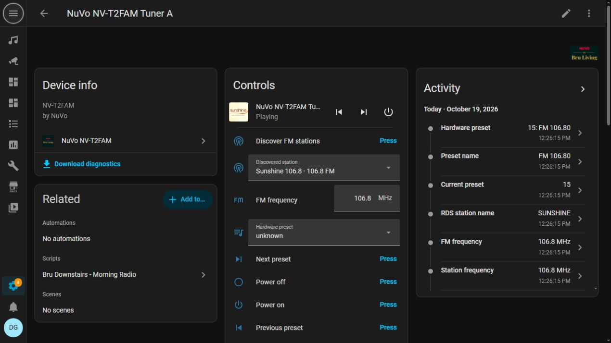
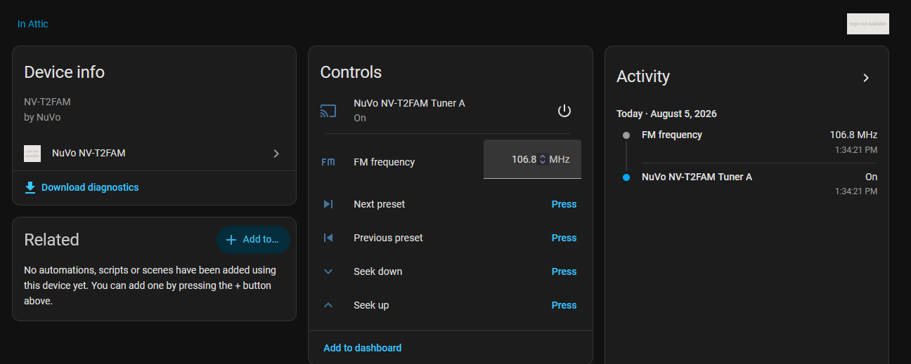
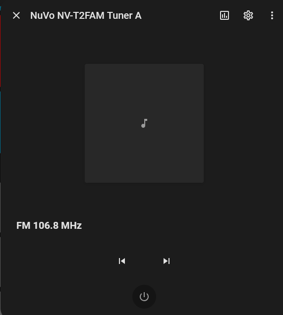

# NuVo NV-T2FAM for Home Assistant

**Give your FM tuner a station library, friendly names and a place in your smart home.**

[](https://github.com/hacs/default)
[](https://github.com/bru-living/ha-nuvo-t2fam/releases/latest)
[](https://github.com/bru-living/ha-nuvo-t2fam/actions/workflows/validate.yml)
[](LICENSE)

[](https://my.home-assistant.io/redirect/hacs_repository/?owner=bru-living&repository=ha-nuvo-t2fam&category=integration)

Bring the **NuVo NV-T2FAM** into Home Assistant with local FM tuning, RDS metadata, station artwork and a persistent station collection. Version **1.15.1** adds automatic station discovery and editable presets stored in Home Assistant, so your favourite stations are easy to find without programming the tuner's hardware banks.

The integration controls **one selected tuner, A or B**, through a local serial connection or a transparent serial-over-TCP bridge. It supports **FM, 87.5–108.0 MHz**, in standalone operation without NuVoNet. A single configuration entry is supported; it does not expose both tuners simultaneously.


*Station discovery and saved-station selection in Home Assistant 1.15.1.*

## What's new in 1.15.1

### Discover the stations around you

Press **Discover FM stations** and let the tuner explore the FM band. Discovery uses the tuner's seek function and a follow-up frequency sweep to find additional stations with RDS information. The **Station discovery** sensor reports what it is doing, how many stations it has found and any errors.

Stations are saved as they are found. A later scan adds stations and refreshes RDS names while keeping your custom names and hidden-station choices. Discovery normalises fine-tune offsets to 100 kHz broadcast channels to avoid filling your list with near-duplicates.

**Scanning temporarily retunes the selected tuner and can take several minutes.** Run it when that radio source is not being listened to. At the end, the integration attempts to restore the original frequency and power state; a connection failure can prevent restoration and is reported in the discovery sensor. Reception depends on your antenna and location; stations without decodable RDS can be saved manually.

### Make the station list yours



*Manage saved frequencies, station names and visibility from the device page.*

| Control | What you can do |
| --- | --- |
| **Discovered station** | Jump straight to a saved station by its name and frequency. |
| **Save current station** | Add a manually tuned station, including one discovery did not find. |
| **Station name** | Give the current station a friendly name. Clear it to use RDS again. |
| **Station frequency** | Correct the saved frequency. A change that collides with another saved channel is rejected. |
| **Station visibility** | Hide a station from the normal station list, or show it again. |
| **Remove current station** | Permanently remove the tuned station from the Home Assistant collection. |

These presets are stored in Home Assistant and survive restarts. They are separate from the NV-T2FAM's **20 hardware preset slots in bank 1**; station discovery does not reprogram those slots. Your custom names take priority over abbreviated RDS labels.

For **Station visibility**, choose the station's `Visible:` or `Hidden:` entry to toggle its visibility. Hidden stations remain in the visibility control so you can bring them back.

### Browse favourites from the media player

Once visible local stations exist, they appear in the media player's **source selector**. **Next** and **Previous** move through that collection in frequency order, wrapping at the ends. Before you have visible local stations, those controls use hardware presets instead.

The separate **Hardware preset** selector and preset buttons continue to control the tuner's bank-1 presets. Tune/seek buttons remain available for exploring beyond your saved collection.

### Artwork that follows your station names

The media player looks up station logos using the editable local station name, falling back to RDS or the hardware preset description. This lets a useful name drive artwork matching before RDS arrives. If a logo is unavailable, the integration provides generated station artwork through Home Assistant's media proxy.

Logo lookup currently searches **Irish stations** in the [Radio Browser directory](https://www.radio-browser.info/). It needs internet access and sends the station name to that service; logo images may load from third-party station hosts. **Tuning, RDS and local preset storage remain local.** This integration controls an FM receiver; artwork lookup does not turn it into an internet-radio player.

## Everyday controls

| Entity | Function |
| --- | --- |
| **Media player** | Power, current station, frequency, RDS radio text, artwork, source selection and previous/next. |
| **FM frequency** | Direct tuning from 87.50 to 108.00 MHz in 0.01 MHz steps. |
| **Tune up / Tune down** | Step the tuner with `TUNE+` / `TUNE-`. |
| **Seek forward / Seek backward** | Find the next receivable station with `SEEK+` / `SEEK-`. |
| **Hardware preset** | Select one of the 20 presets in bank 1, with descriptions learned as they are reported. |
| **State sensors** | Frequency, hardware preset number and name, RDS station name and radio text. |
| **Station discovery sensor** | Discovery status, saved stations, scan timestamps and error details. |
| **Diagnostics** | Firmware/hardware version, connection state and reconnect information. |

RDS is read again after tuning and cached by frequency. Empty RDS responses preserve valid metadata, and the card falls back to a station label or frequency when there is no station text.

### Home Assistant views

These screenshots show the core device controls and media-player view. Available controls and layout vary with your Home Assistant frontend; the new station-management entities are described above.





## Install with HACS

The integration is included in the default HACS catalogue.

1. Open **HACS** and search for **NuVo NV-T2FAM**.
2. Download the integration and restart Home Assistant.
3. Open **Settings → Devices & services → Add integration** and search for **NuVo NV-T2FAM**.
4. Choose your connection and tuner, then finish setup.

You can also use the **Add to HACS** button above. If needed, add `https://github.com/bru-living/ha-nuvo-t2fam` under **Custom repositories** with category **Integration**.

### Manual installation

Download the ZIP attached to the [latest release](https://github.com/bru-living/ha-nuvo-t2fam/releases/latest). Copy its `custom_components/nuvo_t2fam` folder into your Home Assistant configuration directory:

```text
/config/custom_components/nuvo_t2fam/
```

Restart Home Assistant, then add the integration from **Settings → Devices & services**.

## Connect your tuner

| Option | Setting |
| --- | --- |
| **TCP** | Hostname/IP and raw TCP port of your serial bridge; the default port is 4999. |
| **Serial** | Local device path, for example `/dev/ttyUSB0`. |
| **Tuner** | A or B. Only the chosen tuner receives entities. |

Serial settings are **57600 baud, 8 data bits, no parity, 1 stop bit, no flow control**, with ASCII commands terminated by a carriage return. A TCP bridge must provide a transparent/raw serial connection; suitably configured Global Caché devices can be used.

Setup, reconfiguration and startup request `*VER` and require an NV-T2FAM response. Command writes are paced and serialised, with automatic reconnection, backoff and silent-connection monitoring.

To change the endpoint or selected tuner, open the integration's three-dot menu and choose **Reconfigure**. The replacement connection is tested before it is saved.

## First station collection

1. Open the NV-T2FAM device page.
2. Press **Discover FM stations** when the tuner can be temporarily retuned.
3. Follow **Station discovery** until the scan finishes.
4. Choose a **Discovered station**, then adjust its **Station name** if needed.
5. Hide unwanted stations using **Station visibility**.
6. Tune any missing frequency manually and press **Save current station**.

Your chosen names now appear in the media player's source list and guide station-logo matching. No hardware preset programming is required.

## Use it in automations

Tune a frequency directly with the standard media-player action. Replace the example entity ID with yours:

```yaml
action: media_player.play_media
target:
  entity_id: media_player.nuvo_nv_t2fam_tuner_a
data:
  media_content_type: music
  media_content_id: "98.0"
```

Use `media_player.select_source` with the **exact station label shown in your source list**, or use `select.select_option` on the discovered-station entity. These are standard Home Assistant entities, so you can include them in scenes, scripts and room routines.

The tuner integration controls the radio source. Routing that source to rooms and setting amplifier volume are handled by your separate NuVo matrix or amplifier integration.

## Upgrading from 1.8.7

- Existing connection settings and entity identifiers are retained. The old preset selector is now labelled **Hardware preset**.
- Discovery is manual: upgrading does not automatically scan or reprogram the tuner.
- Once visible local stations exist, media-player source labels and Next/Previous use that collection. **Review automations that select numeric hardware preset labels**; the separate Hardware preset selector remains available.
- Local presets live in Home Assistant's managed storage. Include your configuration and managed storage in backups.
- Restart Home Assistant after updating integration files.

## Scope and troubleshooting

This integration supports **FM on one NV-T2FAM tuner in standalone mode**. AM, Sirius, DAB and NuVoNet operation are outside its scope. Power uses the standalone global `*ON` and `*OFF` commands, which affect the physical tuner unit.

Download diagnostics from the integration page to inspect connection and station-discovery details. Host/path values are redacted in downloaded diagnostics. The connection-status sensor stays available during disconnection and includes timestamps, reconnect counts and the last error.

For debug logging:

```yaml
logger:
  logs:
    custom_components.nuvo_t2fam: debug
```

Check the serial settings, bridge port and selected tuner first. If scanning fails, inspect **Station discovery** and the connection sensor. A full-band sweep adds stations when it receives RDS, so weak reception or absent RDS may require manual tuning and **Save current station**.

Report problems in the [issue tracker](https://github.com/bru-living/ha-nuvo-t2fam/issues). Remove credentials and public addresses from logs before sharing them.

See the [changelog](CHANGELOG.md) for release history and [contributing guide](CONTRIBUTING.md) for development information.
